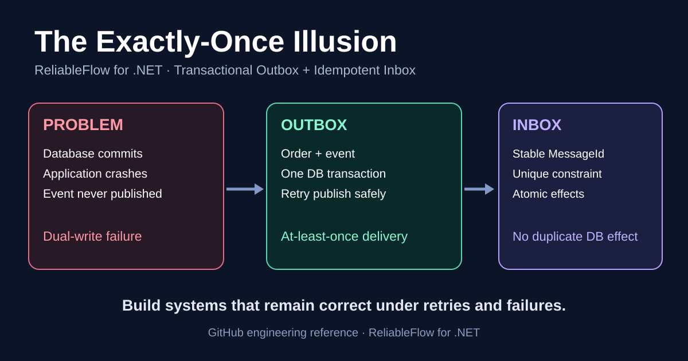
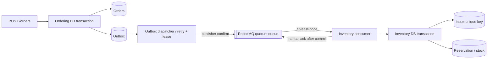

<div align="center">

# ReliableFlow for .NET

### Transactional Outbox + Idempotent Inbox, without the exactly-once illusion

**A reusable EF Core library + an executable ASP.NET Core / PostgreSQL / RabbitMQ failure-lab**

[](https://dotnet.microsoft.com/)
[](LICENSE)
[](docs/VERIFICATION.md)

</div>

> **What if your database transaction commits but your event never reaches the broker?** And what if the broker receives that event, but your publisher crashes before recording success?
>
> This repository intentionally demonstrates **both failure windows** and the mechanisms that make their business effects safe.

<details>
<summary>View the post infographic</summary>



</details>

**Important:** This is a **reusable reference implementation**, not an audited, drop-in production reliability guarantee. It addresses business writes and processed-message markers in **one relational database transaction**; external calls such as payments/emails require separate idempotency protocols. See [Guarantees & Limitations](#guarantees-and-limitations).

## What you get

| Area | Purpose |
| --- | --- |
| `src/ReliableFlow.EntityFrameworkCore` | Broker-agnostic, domain-agnostic, NuGet-packable EF Core outbox/inbox primitives |
| `samples/Ordering.Api` | API saves an order and event atomically; outbox relay publishes via RabbitMQ confirms |
| `samples/Inventory.Service` | Consumes the event, enforces idempotency, reserves stock in a separate database |
| `samples/Shared.Contracts` | Versioned example event (`orders.placed.v1`) |
| `tests/ReliableFlow.Tests` | Unit/integration-style persistence tests using real SQLite constraints and transactions |
| `scripts/e2e.py` | Exercises normal delivery, broker outage, publish-after-confirm failure, and verified duplicate delivery |
| `scripts/e2e_hard_crash.py` | SIGKILLs the real ordering container after a broker confirmation, then verifies lease recovery |
| `tests/ReliableFlow.PostgresStress` | Actual PostgreSQL transaction/unique-index races and concurrent outbox lease claims |
| `docs/EXPLAINED_AR.md` | Beginner-friendly, end-to-end explanation of the failure windows in Arabic |
| `.github/workflows/ci.yml` | Build/tests and optional full Docker Compose journey on GitHub Actions |
| `docs` | Architecture, failure matrix, adoption guidance, and verification honesty |

## Architecture



The **Ordering** and **Inventory** applications have **separate PostgreSQL databases** (`orders_db` and `inventory_db`). No cross-database transaction or distributed 2PC is used.

### Why not just `SaveChanges(); Publish();`?

```csharp
await db.SaveChangesAsync();           // succeeds
await broker.PublishAsync(eventData); // process crashes before this line
```

The order is committed; the consumer never hears about it. If you reverse the calls, the consumer might receive an event for an order that was never committed. An ordinary EF Core transaction cannot atomically commit both your database and RabbitMQ.

## Quick start

**Requirements:** Docker Engine / Docker Desktop with Compose; curl or PowerShell. (The containers bring their own .NET 10 SDK/runtime; no local SDK required to run.)

```bash
git clone https://github.com/Ahmad09ha/ReliableFlow.git
cd ReliableFlow
docker compose up -d --build
```

Wait for both APIs to start, then:

```bash
curl http://localhost:8080/health
curl http://localhost:8081/health
curl http://localhost:8081/stock

curl -X POST http://localhost:8080/orders \
  -H 'Content-Type: application/json' \
  -d '{"sku":"BOOK-001","quantity":2}'

curl http://localhost:8080/outbox
curl http://localhost:8081/reservations
curl http://localhost:8081/inbox
```

The seeded inventory has **100 units of `BOOK-001`**. After the event is processed, inventory should show **98**. `PublishedAtUtc` in the outbox is eventually set and the inbox contains one processed message ID.

**URLs:** Ordering API `localhost:8080`, Inventory API `localhost:8081`, RabbitMQ Management `localhost:15672` (`demo` / `demo_only`). The Postgres credentials in Compose are deliberately **demo-only**, not production secrets.

To run the *whole* failure journey automatically:

```bash
python3 scripts/e2e.py
```

The script assumes freshly initialized databases and checks eventual conditions; see its comments. To reset all demo data:

```bash
docker compose down -v
docker compose up -d --build
```

### Experiment A — publisher unavailable (outbox survives)

```bash
curl -X POST http://localhost:8080/demo/faults/publisher/down
curl -X POST http://localhost:8080/orders -H 'Content-Type: application/json' \
  -d '{"sku":"BOOK-001","quantity":1}'
curl http://localhost:8080/outbox
# Event is pending; no reservation for this new order yet.
curl -X POST http://localhost:8080/demo/faults/publisher/up
# Watch /outbox and /reservations: the pending event is eventually delivered.
```

### Experiment B — confirmed publish, then simulated crash

```bash
curl -X POST http://localhost:8080/demo/faults/fail-after-publish-once
curl -X POST http://localhost:8080/orders -H 'Content-Type: application/json' \
  -d '{"sku":"BOOK-001","quantity":3}'
# One RabbitMQ publish succeeds, then the adapter deliberately throws.
# The relay retries; the inbox skips the duplicate by stable MessageId.
# Exactly ONE reservation exists for that order, and stock decrements once.
```

The fault hook **throws after broker confirmation** to simulate the crash window. It does **not** kill the OS process; a real hard crash would leave a claimed row until its lease expires. The relevant correctness mechanism is the same.

All `/demo/faults/*` endpoints are development-only and Compose binds all exposed ports to `127.0.0.1`.

### Experiment C — actual SIGKILL after a confirmed broker publish

```bash
# Run after the normal E2E test or against an already initialized demo.
python3 scripts/e2e_hard_crash.py
```

The script arms `/demo/faults/pause-after-publish-once`, waits until the
publisher has confirmed RabbitMQ acceptance, kills the **ordering container**
with SIGKILL, restarts it, and verifies re-publication after lease expiry.
It checks the receiver's observed duplicate count and confirms the stock
decrement occurred only once. **Development-only destructive experiment.**

### Experiment D — actual PostgreSQL concurrency

```bash
# Run against only a disposable LOCAL PostgreSQL instance from Compose.
export RF_PG_ADMIN_CONNECTION='Host=127.0.0.1;Port=15432;Database=postgres;Username=demo;Password=demo_only'
dotnet run --project tests/ReliableFlow.PostgresStress -c Release
```

The stress harness creates a random throwaway `rfstress_*` database, checks
32 simultaneous deliveries of one message, 24 independent messages, 16
competing outbox dispatchers, and expired-lease recovery, then removes its
own database. PostgreSQL is published on **localhost:15432** to avoid
conflicting with an existing local PostgreSQL installation on port 5432.

## Plug the generic library into another EF Core project

The **library does not reference** `Order`, `Inventory`, RabbitMQ, or any particular business event. Its two integration seams are your `DbContext` and your `IOutboxTransport` adapter.

### Producer: save business data AND event with one `SaveChanges`

```csharp
// In your DbContext.OnModelCreating:
modelBuilder.AddReliableFlow();

// In Program.cs, after AddDbContext<AppDbContext>:
services.AddSingleton<IOutboxTransport, YourBrokerTransport>();
services.AddReliableOutbox<AppDbContext>();

// In any application service, with your existing scoped AppDbContext:
db.Invoices.Add(invoice);
db.EnqueueOutbox("billing.invoice-created.v1", new { invoice.Id, invoice.Total });
await db.SaveChangesAsync(cancellationToken); // ONE database transaction
```

If you already opened a transaction for a larger business operation, `EnqueueOutbox` stages its row and **your calling code** is responsible for committing both together. **Never save the business entity in one DbContext/transaction and the outbox event in a different one.**

Implement `IOutboxTransport` for your transport (RabbitMQ, Kafka, Azure Service Bus, etc.), and ensure **real durability acknowledgments** where the broker supports them:

```csharp
public sealed class YourBrokerTransport : IOutboxTransport
{
    public Task PublishAsync(OutboxMessage message, CancellationToken ct)
    {
        // Publish message.Payload with stable MessageId = message.Id
        // and routing/contract name = message.EventType.
        // Return only after the broker confirms acceptance.
        throw new NotImplementedException();
    }
}
```

### Consumer: run the handler inside an inbox transaction

```csharp
// In your receiving DbContext.OnModelCreating:
modelBuilder.AddReliableFlow();

services.AddReliableInbox<PaymentsDbContext>();

// Inside a broker receiver, before acknowledging the message:
var outcome = await inbox.ProcessAsync(
    db,
    consumerName: "billing.charge-reservation.v1",
    messageId: incomingMessageId,
    handle: async (sameDb, ct) =>
    {
        sameDb.PaymentReservations.Add(new PaymentReservation { /* ... */ });
    }, cancellationToken);

// ACK only after ProcessAsync returned Processed or Duplicate.
```

`InboxProcessor` stores `(ConsumerName, MessageId)` under a database composite primary key. It inserts the marker **before** executing business logic but **commits both together**, so simultaneous retries cannot both apply transactional effects. Use the **same DbContext** passed to the handler; external HTTP calls and payment gateways need their **own** idempotency keys.

### Build as a local NuGet package

```bash
dotnet pack src/ReliableFlow.EntityFrameworkCore/ReliableFlow.EntityFrameworkCore.csproj -c Release -o ./artifacts
# From a consuming project:
dotnet add package ReliableFlow.EntityFrameworkCore --version 0.1.0 --source /path/to/artifacts
```

**Before production adoption:** Run CI and a concurrency stress test against your intended database provider; use EF Core migrations rather than the demo's `EnsureCreated`. The local verification results do not imply production certification.

## Guarantees and limitations

| Guarantee / behavior | Precise scope |
| --- | --- |
| Atomic business + event write | Only when both share the same relational `DbContext` transaction |
| Event eventually retried | While the relay runs, durable DB and broker are available, and the event remains in outbox; no hard stop on errors |
| Multi-instance publish claims | Conditional SQL lease update with unique lease token; expiry can cause duplicate publication |
| Idempotent consumer effects | Writes inside the *same receiving DB transaction*; unique `(ConsumerName, MessageId)` marker |
| Ordering | **Not guaranteed** globally or per aggregate. Add versions/sequences/ordered partitioning if needed |
| External calls | **Not guaranteed** exactly once; use external idempotency keys / separate patterns |
| Broker delivery | **At least once**, not exactly once |
| Persistent high-throughput publishing | Demo RabbitMQ adapter opens a connection per send; replace with pooled/persistent channel strategy |
| Failed poison messages | Quorum queue delivery limit and DLQ in sample; inspect DLQ, alert and implement replay policy |
| Security | Demo has no authentication; fault endpoints development-only; do not expose on public networks |
| Production suitability | Reference implementation, **not audited or production certified** |

Operational gaps intentionally left to adopters: EF migrations, structured production monitoring/metrics, permanent failures/alerting, retention/archival policy for inbox/outbox, aggregate ordering, and production transport connection pooling. The included concurrency and chaos tests are **evidence for the tested environment**, not a production certification. See [docs/VERIFICATION.md](docs/VERIFICATION.md).

## Development

### Local verification status

As of **2026-11-14**, the Windows/Rider reference implementation has a
zero-warning .NET 10 Release build, **9/9 passing unit tests**, passing
PostgreSQL 18 concurrency and lease tests, passing real RabbitMQ normal/retry/
duplicate E2E, and a passing real Windows process-kill recovery scenario.
The latter verified stock **100 → 99**, exactly **one reservation**, and a
recorded duplicate delivery after the relay restarted.

**Docker Compose on Linux and hosted GitHub Actions remain unverified** until
their runs succeed. See [Verification](docs/VERIFICATION.md) for precise
evidence, and [Arabic walkthrough](docs/EXPLAINED_AR.md) to learn the
concepts step by step.

```bash
dotnet restore ReliableFlow.slnx
dotnet build ReliableFlow.slnx --configuration Release
dotnet test ReliableFlow.slnx --configuration Release
dotnet pack src/ReliableFlow.EntityFrameworkCore/ReliableFlow.EntityFrameworkCore.csproj --configuration Release
```

Read next: [Architecture](docs/ARCHITECTURE.md) · [Failure Matrix](docs/FAILURE-MATRIX.md) · [Adoption Guide](docs/ADOPTION.md) · [Operations Runbook](docs/OPERATIONS.md) · [Verification Status](docs/VERIFICATION.md) · [Publish to GitHub](docs/PUBLISH_TO_GITHUB.md).

## License

MIT. See [LICENSE](LICENSE). If this project is useful, a star is appreciated; suggestions and bug reports are welcome.
